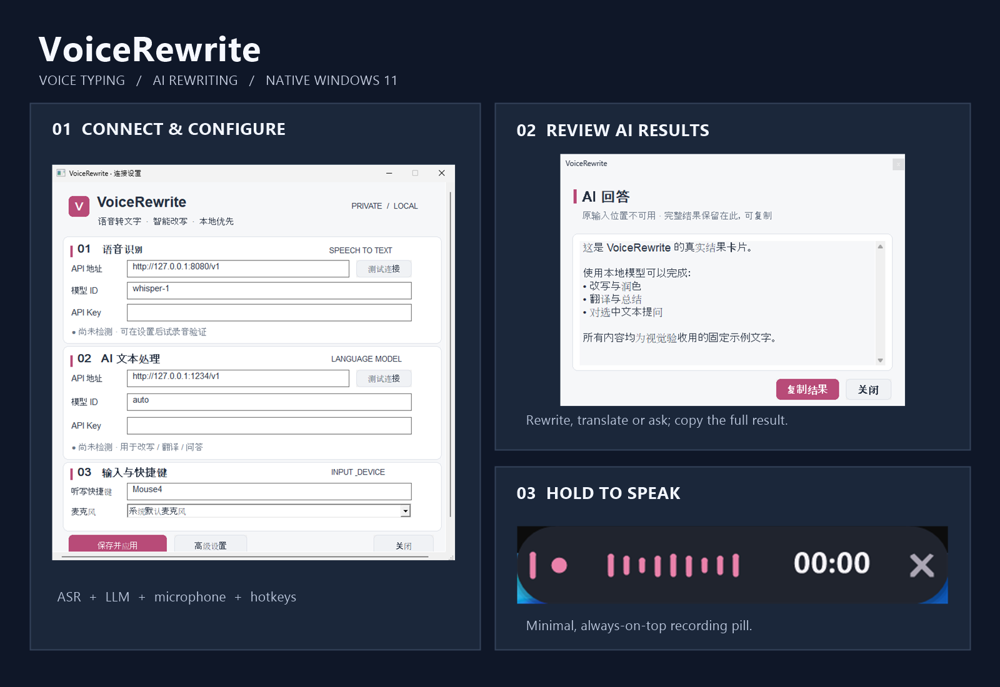
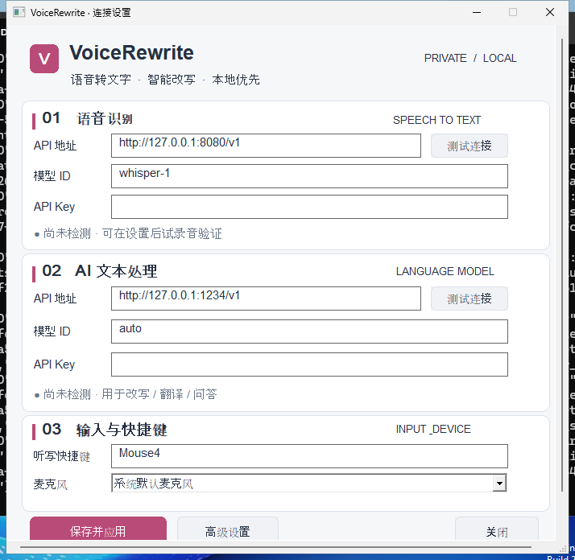
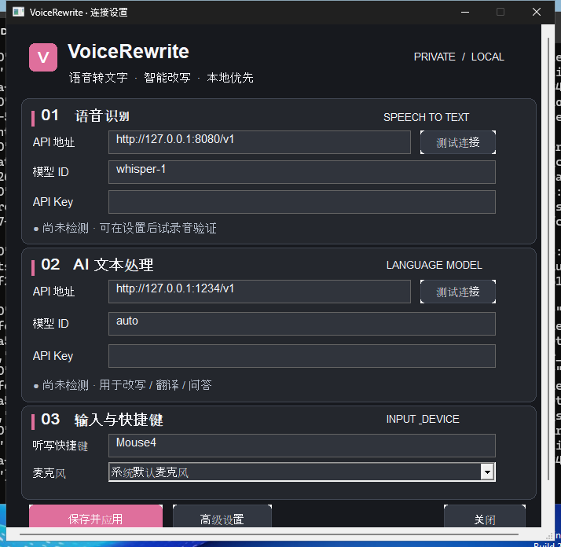
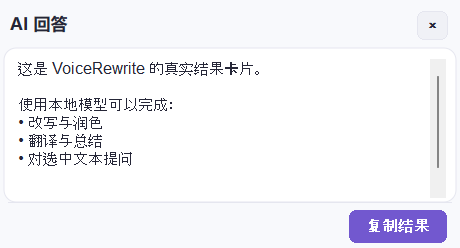

# VoiceRewrite — Voice Typing & AI Rewriting for Windows

**A lightweight native Windows 11 desktop app** for dictating into other apps, rewriting selected text, translating, and asking AI questions. Written in **Go + Win32**; no Electron, Node.js app runtime, or browser UI.

**Hold Mouse4 to speak → release to transcribe.** Select text and hold **Mouse5** to ask AI to rewrite it. Configure your own OpenAI-compatible **ASR** and **LLM** servers—local or remote.

## See the app · 界面预览

*Real screenshots captured from the running Windows EXE in GitHub Actions. The recording overlay is shown in preview mode without microphone audio. [How screenshots are kept up to date](voice-rewrite/VISUAL-TESTING.md).*

<table>
  <tr>
    <td width="50%" align="center"><strong>Settings · 浅色</strong> </td>
    <td width="50%" align="center"><strong>Settings · 深色</strong> </td>
  </tr>
  <tr>
    <td align="center"><strong>AI result · 改写 / 问答</strong> </td>
    <td align="center"><strong>Recording overlay · 录音浮条</strong> </td>
  </tr>
</table>

## How it works

**1. Dictate:** Focus any text field, hold Mouse4 (or your configured F-key), speak, and release. VoiceRewrite transcribes and attempts insertion at the original caret.

**2. Rewrite:** Select text, hold Mouse5, and say how you want it edited or translated. Explicit edits attempt guarded replacement; questions open a result card.

**3. Review:** Copy the complete text from the result card if the target application cannot be edited safely. Long answers scroll without truncation.

## Install and run

Download an artifact from [GitHub Actions](https://github.com/xujinheng/windows-voice-rewrite/actions) after a successful build:

- `VoiceRewrite-installer-windows-x64`: per-user Inno Setup installer, Start-menu shortcut, optional desktop shortcut, and uninstall.
- `VoiceRewrite-portable-windows-x64`: portable ZIP + SHA-256 checksum.
- `Qwen3-ASR-OneClick-Windows-x64`: independent ASR launcher.

**The installer is unsigned.** Windows SmartScreen may warn. The owner must arrange verified publisher signing and interactive Windows testing before claiming production-stable distribution. There is no automatic update client.

First run opens ASR and LLM settings. Default examples are `http://127.0.0.1:8080/v1` (ASR) and `http://127.0.0.1:1234/v1` (LLM); these URLs do **not** start servers automatically. See [usage and limitations](voice-rewrite/README.md).

### Qwen3-ASR OneClick

The restored original [OneClick source](oneclick/) builds separately and can launch a compatible `llama-server.exe` with ASR GGUF and mmproj. The OneClick original API is `8081`; if keeping VoiceRewrite's ASR default `8080`, use the [v19-compatible preset](oneclick/config.voicerewrite-v19.example.json), placing the OneClick proxy at `8080` and llama.cpp at `8082`. OneClick does not bundle any models, CUDA libraries, or llama.cpp binary.

## Privacy and safety

VoiceRewrite sends audio and selected text only to the configured API services, which may be remote. DPAPI encrypts API Keys locally. Clipboard backups remain in memory and are restored only while the app still owns the clipboard sequence. GDI, delayed-rendered and private OLE clipboard objects cannot be guaranteed to survive automatic selection actions, which are refused when they cannot be backed up. Native password-style edit controls are blocked; browser password detection is not complete. Text insertion in third-party editors remains best effort. Read [PRIVACY.md](PRIVACY.md) and [SECURITY.md](SECURITY.md).

## Source, contribution and release

The native Go application is in [`voice-rewrite/`](voice-rewrite/); the independent launcher is in [`oneclick/`](oneclick/). See [`CONTRIBUTING.md`](CONTRIBUTING.md), [`CHANGELOG.md`](CHANGELOG.md), and [`installer/`](installer/). CI checks Go formatting, Linux race tests, Windows tests, vet and cross-builds, and generates portable ZIP and installer artifacts. Git tags beginning with `v` generate **preview releases**, not automatically stable releases.

**Repository license is not decided.** Public availability of this source does not grant a redistribution license; the owner must choose one before presenting it as licensed open-source software.

## v25 Windows usability & privacy

The tray can check the GitHub Releases feed on demand (no silent installer downloads). The Settings window can select an input microphone, and a bounded Microsoft UI Automation worker checks the focused element's password status in addition to native password styles. See [v25 details](voice-rewrite/EXPERIENCE-V25.md).

### v26 in-memory recovery and functional ASR checks

The native tray offers a memory-only list of the last 10 dictation/rewrite results and a clear-history command. It deliberately shows no transcript text in menu labels. The ASR connection check sends a generated silent WAV through the actual transcription endpoint, identifying HTTP 415 and unsupported routes rather than mistaking `/models` for audio capability. See [v26 notes](voice-rewrite/EXPERIENCE-V26.md).
