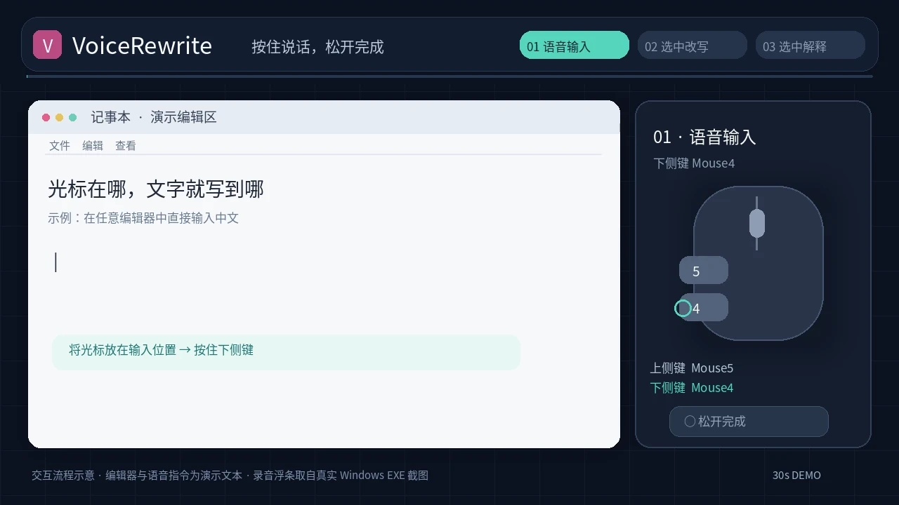

# VoiceRewrite

Voice typing and AI text editing for Windows 11. Built with Go and native Win32.

[Watch the 30-second demo](docs/demo/voicerewrite-demo.mp4) · [View screenshots](docs/ui/overview.png)

**Mouse4 (lower side button)** — hold to dictate, release to insert text at the cursor.

**Mouse5 (upper side button)** — select text, hold and speak an instruction to rewrite, translate or explain it. Edits can replace the selection; answers appear in a copyable result card.

*The walkthrough uses example text and scripted actions.*

## Screenshots

<table>
<tr><td width="50%"></td><td width="50%"></td></tr>
<tr><td></td><td></td></tr>
</table>

## Install

Download the **Windows installer** or **portable ZIP** from [GitHub Actions](https://github.com/xujinheng/windows-voice-rewrite/actions/workflows/build.yml). The installer is currently unsigned; Windows SmartScreen may display a warning.

On first launch, configure your speech recognition (ASR) and text generation (LLM) API endpoints, model IDs and any required API keys. Both services use OpenAI-compatible APIs and may run locally or remotely.

Typical local endpoints:

- ASR: `http://127.0.0.1:8080/v1`
- LLM: `http://127.0.0.1:1234/v1`

Servers and models must be started separately. See [setup and usage](voice-rewrite/README.md), [Qwen3-ASR launcher](oneclick/README.md) or [local server script](scripts/local-models/README.md).

## Notes

- Audio and selected text are sent to the API endpoints you configure. See [privacy](PRIVACY.md).
- Text replacement depends on the target application and may fall back to a result card.
- API keys are stored with Windows DPAPI; recent text results remain in memory for the current session.
- [Build and contribute](CONTRIBUTING.md) · [Security](SECURITY.md) · [Windows testing](voice-rewrite/TESTING.md)

**License:** [BSD 3-Clause](LICENSE). You may use, modify and redistribute VoiceRewrite, including commercially, subject to the license conditions. See [third-party notices](voice-rewrite/THIRD_PARTY_NOTICES.md) for existing attribution and separately licensed material.
